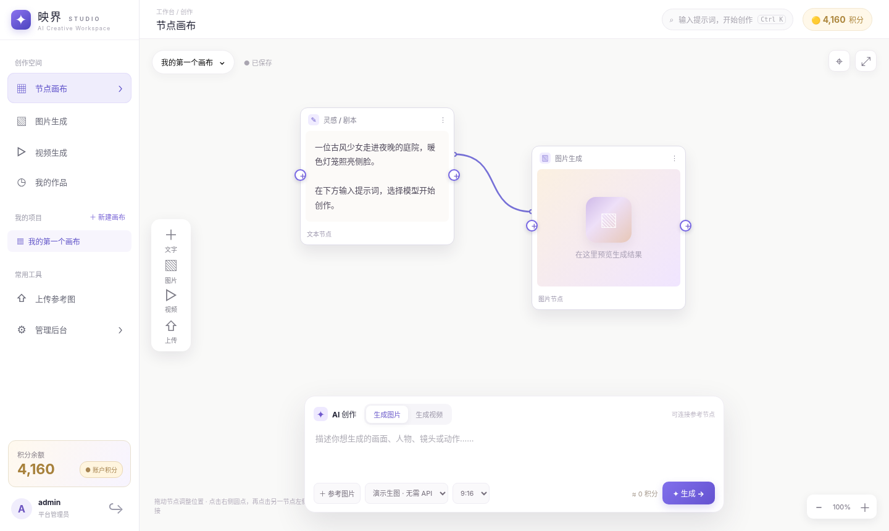
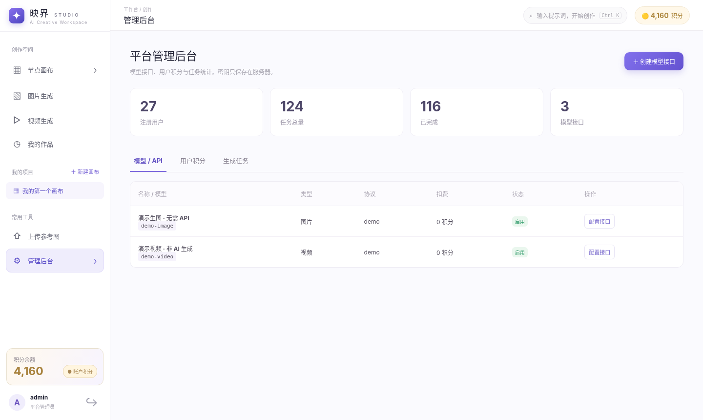

# 雪宝 Studio 初始版本说明

> 本文保留初始 MVP 的设计记录，其中启动方式、模型能力、画布及注册行为已发生变化。当前完整项目请以仓库根目录的 [README](../../README.md) 为准。

这是一个**原创实现**的全栈起步项目：参考用户提供的“节点画布”交互形式，以及 [Toonflow-app](https://github.com/HBAI-Ltd/Toonflow-app) 的产品方向，**不包含/复制 Toonflow 源码**。定位为“多用户网页 SaaS + 管理员模型配置”，而非 Toonflow 桌面客户端的直接修改版。

> 当前版本是供本地体验与二次开发的 **MVP**，不是经过完整安全审计、支付对账和高并发压测的商用生产版本。

## 已有功能

- ✅ 用户注册、登录、退出；管理员独立权限（服务端鉴权）
- ✅ 画布节点拖动、连接、缩放、居中；文字、图片、视频节点；项目自动保存
- ✅ 图片上传、参考图；图片生成结果作为后续视频生成的参考
- ✅ 图片、视频任务提交、异步状态轮询、成功预览、失败展示、下载、作品历史
- ✅ 后台创建、编辑、启停模型：协议/地址/API Key/请求 JSON/响应路径/积分成本
- ✅ `demo`、`sync_json`、`async_json` 三类适配；可使用 GET 查询异步任务
- ✅ 积分原子扣减；任务失败自动且幂等退还积分；用户资产隔离
- ✅ SQLite 持久化，密钥使用 Fernet 对称加密存储；上传图转码及大小限制
- ✅ Docker / 本地启动

### 用户端预览



### 管理后台预览



_上述截图仅是页面渲染预览，后台的统计数字与画布内容均为模拟展示，不代表实际生成模型已连接。_

## 快速安装（推荐 Docker）

安装 Docker Engine、Docker Compose 后执行：

```bash
cp .env.example .env
# 编辑 .env，建议设置 ADMIN_PASSWORD 为不少于 12 位的强密码
# 如果没设置，将自动生成一个随机初始密码

docker compose up -d --build
```

默认只监听本机 `http://127.0.0.1:8000`，不会直接暴露到公网。如果没有在 `.env` 里填写管理员密码，第一次启动时执行：

```bash
docker compose exec studio cat /app/data/admin-initial-password.txt
```

打开 `http://127.0.0.1:8000`，登录后即可进入画布。你可以通过注册按钮创建测试用户（默认赠送 100 积分）。

> 镜像预装 FFmpeg，演示视频会生成约 3 秒带 `NOT AI GENERATED` 字样的占位短片，**不代表成功接入真实 AI 视频模型**。

### 不使用 Docker，直接运行

适用于 Python 3.11+，需要 FFmpeg（用于视频演示），在仓库根目录：

```bash
python -m venv .venv
# Linux / macOS
source .venv/bin/activate
# Windows PowerShell: .venv\Scripts\Activate.ps1
pip install -r requirements.txt
uvicorn backend.main:app --host 127.0.0.1 --port 8000 --workers 1
```

管理员账号默认为 `admin`，密码若未在环境变量中设置，会保存在 `data/admin-initial-password.txt`。**不要把 data/ 目录公开或上传到 Git 仓库。**

## 后台接 API 的方法

1. 管理员登录 → 左侧 **管理后台** → **创建模型接口**。
2. 选择图片或视频、选择适配协议、填模型代号与 API 地址。
3. 填 API Key，选择 Bearer 或 Header 方式认证。Key 保存在服务端，不会回传到浏览器。
4. 按供应商文档设置 `请求 JSON 模板`、`输出 URL 路径`；异步模型还需任务 ID 和状态路径。
5. 设置扣费积分、启用，点击保存。用户端模型下拉框会显示新模型（刷新页面或切换回来）。

**注意：**“后台配置即可接入”仅对请求/响应符合这三种通用协议的接口成立。Multipart 上传、特殊签名、WebSocket、POST 查询任务、回调签名、特殊媒体格式等供应商协议，仍需增加专用 Adapter。详见 [`docs/API-ADAPTERS.md`](docs/API-ADAPTERS.md)。

## 模型模板示例

### 示例 A：同步生成图片的 JSON API

（请根据真实供应商文档修改地址和字段，以下均为**示例格式**，不是可直接调用的真实接口）

- 名称：通用图片模型
- 类型：图片
- 协议：`sync_json`
- 提交地址：`https://api.example.com/v1/images/generations`
- 鉴权：Bearer
- 模型代码：`image-demo-v1`
- 请求模板：

```json
{
  "model": "{{model}}",
  "prompt": "{{prompt}}",
  "size": "1024x1536"
}
```

- 假设 API 响应 `{"data":[{"url":"https://...png"}]}`，则输出路径填写 `data.0.url`。

### 示例 B：异步生成视频的 JSON API

- 类型：视频
- 协议：`async_json`
- 提交地址：`https://api.example.com/v1/videos`
- 查询 URL：`https://api.example.com/v1/videos/{{task_id}}`
- 请求 JSON：

```json
{
  "model": "{{model}}",
  "prompt": "{{prompt}}",
  "aspect_ratio": "{{ratio}}",
  "duration": "{{duration}}",
  "reference_image": "{{reference_base64}}"
}
```

- 假设提交响应：`{"data":{"task_id":"abc123"}}`，任务 ID 路径：`data.task_id`。
- 假设查询响应：`{"data":{"status":"completed","video_url":"https://...mp4"}}`，状态路径：`data.status`，输出路径：`data.video_url`。
- 完成状态：`completed,succeeded,success`，失败状态：`failed,error`。
- 当前轮询方式：`GET`（每 4 秒一次，最长约 12 分钟）。

**参考图**：`{{reference_base64}}` 为图片的 `data:image/jpeg;base64,...` 数据 URI；只有供应商支持此输入格式才可直接使用。远程图片 URL 参考也支持 `{{reference_image}}`，本地用户上传图片不会自动对外公开。

## 目录结构

```text
backend/
  main.py        # 用户/项目/任务/积分/模型 API
  db.py          # SQLite 和鉴权加密
  adapters.py    # 通用同步/异步上游和演示生成器
web/
  index.html     # 用户端与管理后台页面
  style.css      # UI 样式
  app.js         # 节点交互和 API 客户端
docs/
  API-ADAPTERS.md
  preview-*.png
Dockerfile
compose.yaml
requirements.txt
.env.example
```

## 常见问题

**启动以后显示没有模型？** 默认带两个 `demo` 模型，若仍没有请查看 `/api/models` 网络请求、浏览器控制台和用户登录状态。

**积分怎么计费？** 管理员为每个模型配置一个固定积分成本（本 MVP 未区分分辨率和秒数）。创建任务时原子扣除，明确失败时返还。未来可添加按秒/分辨率/模型动态定价。

**图片和视频真的是 AI 生成的吗？** 只有在后台填入你自己的真实模型 API、有效的 Key 和正确的返回格式，才会调用第三方 AI。演示模式故意以占位图片/短片替代真实 AI 结果，不消耗 API 费用。

**为什么部署到公网前需要进一步开发？** 当前使用单实例内进程任务，没有 Redis/Celery 等持久队列；还缺少邮件验证、忘记密码、支付网关、风控、请求频率限制、版权审核、供应商签名/回调、平台监控与 SLA 等。应完成下方清单后再正式运营。

## 生产上线前必须处理

1. 使用独立域名、HTTPS 和可信反向代理，设置 `COOKIE_SECURE=1`、高强度管理员密码，按需关闭公开注册 (`ALLOW_SIGNUP=0`)；启用登录限流和 CSRF 的进一步防护。
2. 将 SQLite 迁移为 PostgreSQL，生成任务迁到 Redis + Celery/RQ（或独立 Worker）；多副本并发时不能直接复制当前 `launch_job` 设计。
3. 作品迁至私有对象存储，用户使用带权限/有效期的签名链接访问；处理第三方模型引用素材时的临时签名 URL。
4. 配置出站网络白名单、防 DNS 重绑定、请求大小限制，确保 API Key 不入日志；`ALLOW_PRIVATE_PROVIDER_URLS` 默认保持关闭。
5. 增加第三方错误码映射、幂等请求、超时后查询/退款对账、任务取消和供应商真实成本核算。
6. 增加支付订单、回调验签、充值账本、用户协议/内容合规审核、内容举报和运营监控。
7. 商业化部署前检查所接入各家 AI 服务商的 API 授权、价格条款、转售限制与生成内容政策。

## 开源参考

Toonflow-app 当前采用 MIT License。这个演示项目是参照需求重新编写的**独立示例**；若日后你直接复制、合并或修改 Toonflow 源码，须按 MIT License 保留该项目版权及许可声明。
